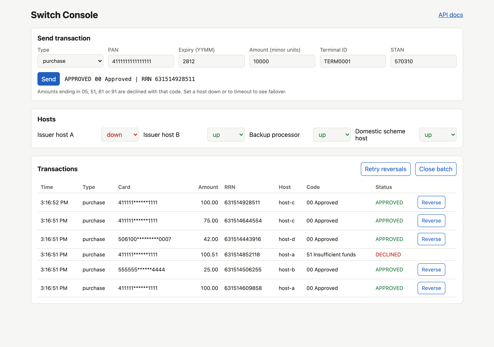
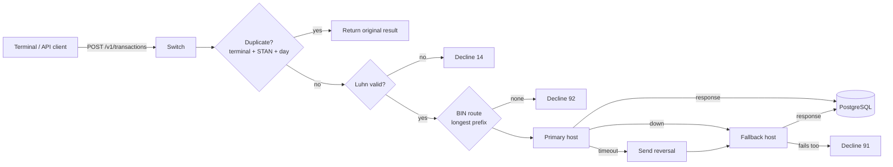

# payment-switch-simulator

[](https://github.com/dobdaniel1/payment-switch-simulator/actions/workflows/ci.yml)


A small card payment switch you can run locally and break on purpose.

It routes card transactions by BIN to simulated issuer hosts, fails over when a host is down or slow, reverses transactions safely, settles the day's approvals and reconciles the result against a host settlement file. Every failure mode can be triggered from the API or the built-in console, which makes it a realistic target for test automation. The [qa-automation-framework](https://github.com/dobdaniel1/qa-automation-framework) repo tests it end to end.



## Run it

```bash
docker compose up --build
```

- Console: http://localhost:8000
- API docs (OpenAPI): http://localhost:8000/docs

Without Docker (SQLite):

```bash
python -m venv .venv && . .venv/bin/activate
pip install -e ".[dev]"
uvicorn app.main:create_app --factory --reload
pytest
```

## How it works



### Routing

| BIN prefix | Primary | Fallback |
|---|---|---|
| 4 | host-a | host-c |
| 51 to 55, 2 | host-b | host-c |
| 5061 | host-d | none |

### Test triggers

| To get | Do this |
|---|---|
| Approval | Any valid test card, amount not ending in a decline value |
| 05, 51, 61, 91 decline | Purchase amount whose minor units end in 05, 51, 61 or 91 (for example 10051) |
| 54 expired card | Expiry before the current month |
| 14 invalid card | PAN that fails the Luhn check |
| 92 no route | PAN with an unrouted BIN, such as 6011000990139424 |
| Failover | `PATCH /v1/hosts/host-a {"status": "down"}` |
| Timeout with reversal | `PATCH /v1/hosts/host-a {"status": "timeout"}` |
| Store and forward | Reverse while the host is down, then `POST /v1/reversals/retry` once it is up |
| Duplicate | Repeat terminal ID and STAN on the same day |

## API

| Method | Path | Purpose |
|---|---|---|
| POST | /v1/transactions | Authorize a purchase or refund (201 new, 200 duplicate) |
| GET | /v1/transactions | List, filter by `status` |
| GET | /v1/transactions/{id} | Fetch one |
| POST | /v1/transactions/{id}/reversal | Reverse an approved, unsettled transaction (idempotent) |
| POST | /v1/reversals/retry | Resend queued reversals |
| GET, PATCH | /v1/hosts, /v1/hosts/{id} | View hosts, set `up`, `down` or `timeout` |
| GET | /v1/routes | BIN routing table |
| POST | /v1/settlement/batches | Close the day's batch |
| GET | /v1/settlement/batches/{id}/file | Settlement file (CSV) |
| POST | /v1/settlement/batches/{id}/reconcile | Upload host CSV, get matched, mismatched, missing and duplicate items |
| POST | /v1/admin/reset | Reset data for test runs (disable with `ENABLE_ADMIN=false`) |

## Design decisions

- **No clear PANs stored.** The switch keeps a masked PAN for display and a keyed HMAC for matching.
- **Idempotency by terminal, STAN and business date**, backed by a unique constraint so concurrent retries cannot double charge.
- **Reverse before failover.** A timed out host may still have approved, so the switch reverses there before trying the fallback.
- **Store and forward reversals** when the original host is unreachable.
- **Settled transactions cannot be reversed**; a refund is the correct path after settlement.
- **Totals per currency**, so a mixed batch never sums naira and dollars together.
- **Clock injected as a dependency**, so tests control business dates.

## Tests

55 tests at 99% coverage: routing, every decline path, failover, timeouts, duplicates, reversals, store and forward, settlement totals, settlement files and reconciliation exceptions. CI also starts the Docker stack and runs a smoke test against PostgreSQL.

All card numbers are public test numbers.

## License

MIT
